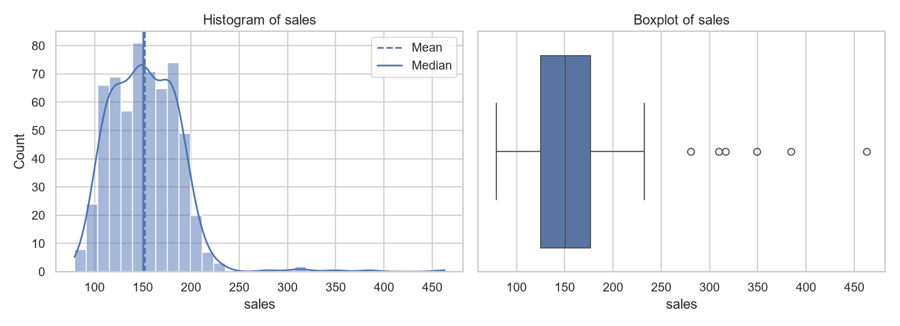
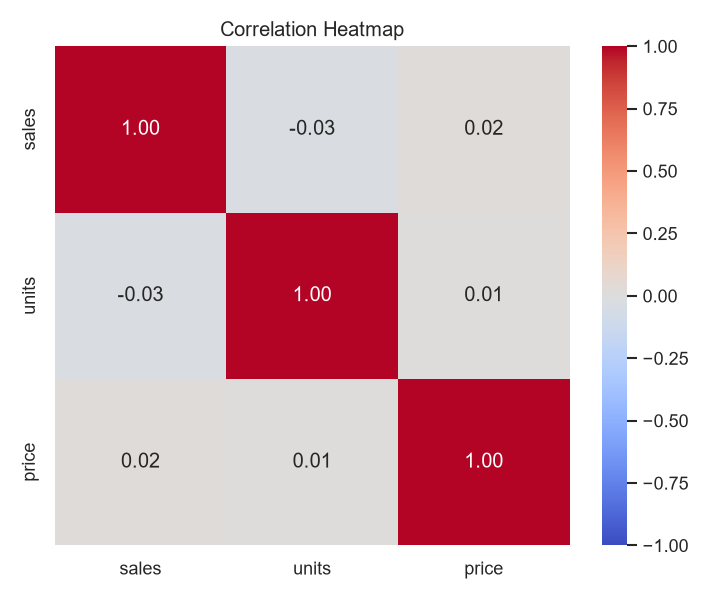
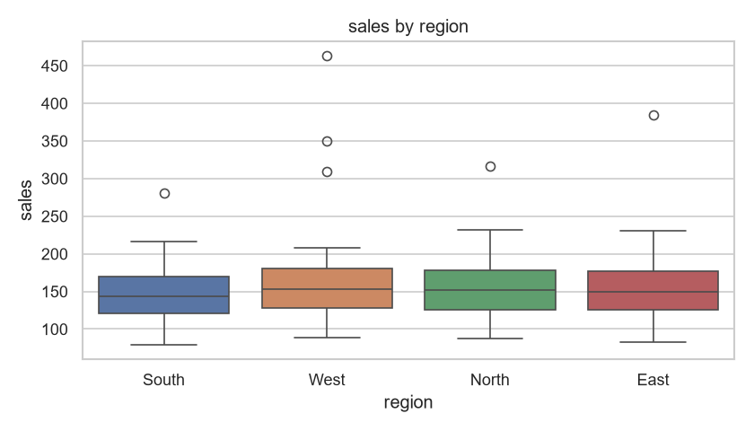
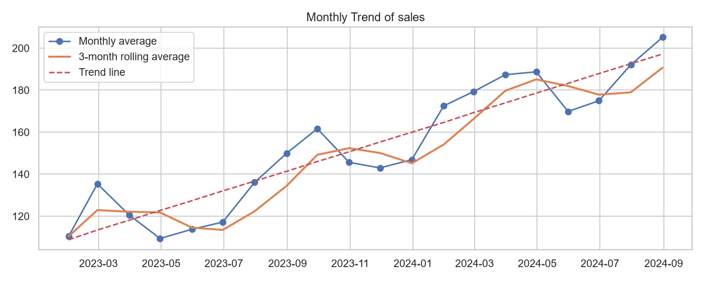

# Python Data Analytics: From Fundamentals to Interactive Dashboards

A hands-on, progressive curriculum covering core data manipulation, statistical analysis, relational joins, data cleaning, exploratory data analysis (EDA), and interactive dashboard development in Python.

[](https://www.python.org/)
[](https://pandas.pydata.org/)
[](https://seaborn.pydata.org/)
[](https://dash.plotly.com/)

---

## 🎯 What is Being Learned? (Curriculum Overview)

This repository demonstrates the step-by-step evolution of a **Data Analyst** skillset in Python:

| Module / Practical | Core Focus | Key Concepts & Functions Learned |
| :--- | :--- | :--- |
| **[pr_1](./pr_1/)** | **Pandas Fundamentals & Basic Stats** | DataFrames, conditional indexing / boolean masking (`df[df['Marks'] > 50]`), sorting (`sort_values`), grouping (`groupby`), and central tendency measures (`mean`, `median`, `mode`). |
| **[pr_2](./pr_2/)** | **Data Transformation & Logic** | Custom scoring functions, column-wise transformation using `.apply()`, conditional classification (Distinction / Pass / Fail), and basic aggregates (`min`, `max`, `sum`). |
| **[pr_3](./pr_3/)** | **Relational Joins & Merges** | Dataset union & stacking (`concat` axis=0 / axis=1), SQL-style merges (`inner`, `left`, `right`, `outer`), index joins (`df.join`), mismatched key merges (`left_on`/`right_on`), and multi-key composite joins. |
| **[pr_4](./pr_4/)** | **Data Cleaning & Date Engineering** | Data type casting (`astype(int)`), text cleaning (`str.strip()`, `str.title()`), datetime parsing (`to_datetime`), and date feature extraction (`dt.year`, `dt.month`, `dt.day`). |
| **[pr_5](./pr_5/)** | **End-to-End Exploratory Data Analysis (EDA)** | Complete statistical data audit (missing values, duplicates, skewness), Tukey's IQR outlier detection, correlation analysis, time-series resampling, rolling averages, linear trend fitting (`polyfit`, $R^2$), and visual exports. |
| **[pr_6](./pr_6/)** | **Interactive BI Dashboard (Plotly Dash)** | Building production-grade web dashboards with Dash & Plotly: multi-select filters, date-range selectors, dynamic KPI cards, and responsive reactive callback architecture. |

---

## 📂 Project Structure

```text
MOCK_TEST_DA/
├── README.md                 # Project documentation and curriculum guide
├── step5_distribution.png    # Generated Target Distribution (Histogram & Boxplot)
├── step7_correlation.png     # Generated Correlation Heatmap
├── step8_groups.png          # Generated Categorical Group Boxplot
├── step9_trend.png           # Generated Time-Series Trend Line with Rolling Avg
│
├── pr_1/                     # Practical 1: Pandas Fundamentals & Statistics
│   └── 1.py, 2.py, 3.py      # Basic DataFrame operations, filtering, grouping
│
├── pr_2/                     # Practical 2: Conditional Logic & Transformations
│   └── 1.py, 2.py, 3.py      # Grade classification, .apply() functions
│
├── pr_3/                     # Practical 3: Merges, Joins & Concatenation
│   └── 1.py, 2.py, 3.py      # Database-style table joins and multi-key merging
│
├── pr_4/                     # Practical 4: Data Cleaning & Datetime Parsing
│   └── 1.py, 2.py, 3.py      # String cleanup, type casting, date extraction
│
├── pr_5/                     # Practical 5: Exploratory Data Analysis (EDA) Pipeline
│   └── 1.py, 2.py, 3.py      # Statistical analysis, outlier detection, trend fitting
│
└── pr_6/                     # Practical 6: Interactive Dashboard with Dash
    └── 1.py, 2.py, 3.py      # Interactive web application with charts and KPI metrics
```

---

## 📊 Visual Analytics Artifacts (From Practical 5)

When executing the EDA pipeline in `pr_5`, several analytical visualizations are generated:

### 1. Target Distribution & Skewness (`step5_distribution.png`)
Evaluates variable shape using Kernel Density Estimation (KDE) and Boxplots, identifying distribution asymmetry and deviations between Mean and Median.



### 2. Correlation Matrix (`step7_correlation.png`)
Visualizes Pearson correlation coefficients across numerical attributes using a Seaborn heatmap.



### 3. Categorical Segmentation (`step8_groups.png`)
Examines variance across geographical regions using grouped boxplots.



### 4. Time-Series Trend & Moving Average (`step9_trend.png`)
Computes monthly resampled sales figures, applies a 3-month rolling average, and calculates a fitted linear regression line with $R^2$ evaluation.



---

## 🚀 Interactive Sales Dashboard (From Practical 6)

`pr_6` launches a local **Dash web server** featuring:
- **Interactive Filters**: Multi-select dropdowns for Region and Category, alongside date-range selection.
- **Dynamic KPI Cards**: Instant metric updates for Total Revenue, Orders, Average Order Value (AOV), and Units Sold.
- **Plotly Visuals**:
  - Monthly Revenue Trend Line
  - Revenue by Product Category (Horizontal Bar)
  - Revenue by Region (Vertical Bar)

To launch the dashboard:
```bash
python pr_6/1.py
```
Then navigate to `http://127.0.0.1:8050/` in your browser.

---

## 🛠️ Tech Stack & Requirements

- **Language**: Python 3.10+
- **Data Manipulation**: `pandas`, `numpy`
- **Visualization**: `matplotlib`, `seaborn`, `plotly`
- **Web Application**: `dash`

Install required packages:
```bash
pip install pandas numpy matplotlib seaborn plotly dash
```

---

## 💡 How to Run Any Practical

You can run any practical file directly with Python:

```bash
# Run Practical 1 (Pandas Basics)
python pr_1/1.py

# Run Practical 3 (Merges & Joins)
python pr_3/1.py

# Run Practical 5 (Full EDA & generates PNG figures)
python pr_5/1.py

# Run Practical 6 (Launches Dash Web Dashboard)
python pr_6/1.py
```
